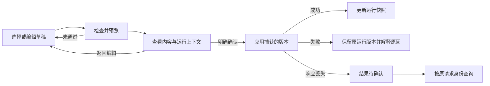

# 界面交互设计提案

状态：**用户已确认（2026-11-10）**。正式界面实现与验证记录见 [实现说明](ui-implementation.md)。本提案面向 Phase 0–2 当前产品范围，提供 [可点击 Web 页面](ui-prototype/index.html) 和 [本地预览说明](ui-prototype/README.md)。它不是对 TUN、服务模式等完整架构能力的提前交付；PAC 基础链路已于 2026-11-12 增加独立页面。

## 页面结构

| 页面 | 用户目的 | 主要内容 |
| --- | --- | --- |
| 总览 | 确认运行是否正常，执行日常启停 | Core、运行配置、本机 HTTP 入口、代理归属、最近活动 |
| 配置 | 管理原生配置并确认变更 | 配置列表；概览 / 本地入口 / 节点 / 分流规则 / 原始 JSON / 历史 |
| PAC | 编辑并验证 PAC 自动代理 | PAC 服务端口；从当前配置生成；导入 / 编辑 / 语法检查；`FindProxyForURL` 测试；当前运行 Revision |
| 诊断 | 解释状态与规则预测 | 本机状态检查（含本地入口 / PAC 服务 / WinHTTP 只读）、运行配置的静态路由预测、实际出口未验证 |
| 日志 | 找到失败原因和操作身份 | 级别、文本筛选、暂停显示、复制结果、请求详情 |
| 设置 | 管理使用环境与偏好 | Core 与依赖、独立启动开关、主题、数据目录说明 |

浅色、深色、跟随系统覆盖所有页面、对话框及托盘预览。窗口缩小时保留导航图标与滚动，配置列表转为横向。状态使用文字表达，不仅通过颜色区分。

## 配置操作合同

用户选择配置只改变编辑对象。编辑、排序、导入、复制和载入历史修改草稿，不能切换运行配置。运行版本始终作为独立快照展示。

草稿、Core 选择或代理上下文变化后，原检查候选失效，即使字段后来改回原值，也必须重新检查。历史记录先比较差异，确认后才载入为新草稿。运行中的配置禁止直接删除。现有后台还保留对上次已应用配置的引用，因此停止后也需先应用另一份配置，再删除原配置。

正式实现需连接现有候选、冻结资源与请求身份合同；浏览器原型仅演示基础结构检查和模拟结果。Core 下载完成不能覆盖用户在下载期间作出的新选择；保存下次 Core 版本也不立即替换运行中的 Core。

## 编辑空间与尺寸

配置编辑区按父容器可用宽高布局：顶部信息与标签栏、底部检查 / 应用操作先分配空间，JSON 和结构化内容占用剩余区域。长行和长文档在编辑区内滚动，短文档仍保留完整编辑背景和可点击输入区域；窗口不足以容纳最小编辑面积时，允许页面滚动。导入与应用预览中的 JSON 共用同一尺寸和滚动规则，预览左右两列保持等高，标题与确认操作不随长文档滚走。

滚动视口限制可见高度，正文按内容自然排布，不压缩超出视口的文本行。预览将自动恢复覆盖限制显示为中文摘要，逐字段详情可展开、换行并独立滚动；区别 Core 配置校验结果与管理器自动恢复能力。新检查候选从顶部打开预览，不沿用旧候选的滚动与展开状态。

## 首次部署

依赖安装 → 添加配置 → 检查预览 → 明确确认启动。展示 XTLS / Xray-core 官方来源、版本和资源准备状态；默认不接管系统代理。正式安装流程应验证真实发布包与依赖，不能使用开发机临时路径作为用户部署前提。

Windows 数据目录默认是程序安装目录下的 `data`，说明可写性要求。当前方案仅展示目录和复制路径；更换目录在退出后通过现有启动参数完成，不引入运行中目录迁移。

## 代理、异常与退出

| 场景 | 页面反馈与可执行操作 |
| --- | --- |
| 不接管系统代理 | 本程序无代理控制权；恢复先前设置后，其他代理可能仍启用 |
| 使用本机 HTTP 代理 | 正式接管前验证兼容入口；接管成功不代表网络可达 |
| 后台断开 | 显示最后已知状态，禁用写操作，允许浏览及重新连接 |
| 恢复受限 | 展示原因与证据，允许查询及安全停止；不能盲目覆盖外部代理 |
| 应用失败 | 保留原运行版本，说明失败原因、修改建议与请求身份 |
| 结果待确认 | 不重复提交；按原请求身份查询后更新运行快照 |
| 执行中 | 禁用冲突变更；保留页面浏览；完整退出请求等待当前操作结束 |
| 关闭窗口 | 收起到托盘，后台与 Core 保持运行 |
| 托盘 退出… | 打开统一确认对话框，选择仅退出界面或退出整个程序；可记住默认选择，默认“仅退出界面” |
| 退出整个程序 | 停止 Core、条件恢复本程序接管的代理并退出；失败时保留错误反馈与查询路径 |

真实网络连通性和实际出口均单独标为未验证；静态路由只能表达预测。原型不提供无来源的速度、流量或延迟数据。

错误提示随运行状态更新：新的应用、代理切换或启停操作成功完成并持久保存结果，且后台没有待恢复问题后，清除旧运行请求错误。普通状态读取、日志查询和历史成功请求重放不作为错误已修复的证据。历史失败保留在日志与操作记录中；本地草稿写入失败和待恢复告警独立保留。

## 确认范围与后续工作

本次确认五页结构、首页层级、草稿与运行版本的区分、应用步骤、代理措辞、三种退出行为及主题风格；2026-11-12 为 PAC 增加独立页面，正式界面现为六页。按现有 Rust / egui 与后台接口落地；配置显示名称和草稿使用独立 GUI 资料文件，日志检索在界面侧处理，运行版本读取和诊断使用新增的只读后台接口。Web 原型不代表决定将正式桌面技术栈迁移为 Web。

## 2026-11-10 收口补充

普通退出必须确认全部草稿已保存，保存失败保留界面，提供返回、重试、导出或明确放弃。设置读取分别维护后台基准与用户草稿；后台应用完成后同步持久化草稿基准。详见 [实现与回归](phase0-2-c18-20-closeout.md)。

移除侧栏“本机连接管理”、底部工作空间 / 存储说明及顶部连接标签；连接正常且没有操作反馈时，底部消息栏隐藏。程序图标采用统一的 X 与连接节点，覆盖托盘、任务栏和标题栏，见 [图标说明](ui-icon.md)。

## 配置向导与协议表单（2026-11-10，用户已确认）

主要输入来源为用户手工提供的服务器地址、端口和认证参数。新建流程为“选择使用场景 → 选择连接模板 → 填写信息 → 保存配置 → 检查并预览 → 明确应用”。场景提供单节点代理、按网站分流与本地直连诊断，已有配置保留独立导入入口。分流场景不预置会影响真实访问的示例规则。

模板提供 VLESS + Reality / TLS、Trojan + TLS、Shadowsocks、SOCKS / HTTP 上游与 VMess 兼容方式。自动准备回环 HTTP / SOCKS 入口、唯一节点 Tag、直连 / 阻止出站及基础路由。远端地址、端口、UUID、密码、Reality 公钥与服务端参数由用户补充；不猜测，不自动关闭证书验证。加密、指纹和 Flow 可选择常用值，安全及传输字段随选择展开。Core 负责最终版本兼容性校验。

节点卡片显示名称、协议和地址 / 端口摘要。名称保存在独立 GUI 资料中，不更改 Tag 和路由引用；导入节点无显示名称时回退到原 Tag。默认访问方式通过下拉选择，完整移动原出站对象，不改动规则顺序。默认出站需先换选后才能删除；其他节点被原生字段引用时阻止常用表单删除，高级编辑保留完整控制。

常用规则表达“网站 / IP → 节点 / 直连 / 阻止”，按原顺序匹配。裸域名输入生成 `domain:`，原生带前缀的匹配器保留语义；导入的裸子串规则和组合规则进入高级编辑，避免表单改变其含义。空匹配项与相同匹配条件提供核对提示，静态提示不代表完整规则冲突分析。

概览中的缺项可点击“去补充”，切换并定位字段；未覆盖的结构使用高级编辑。多服务器 / 用户只在表单编辑首项，其余保留。常用表单和高级原生字段在内容顶部切换，避免长列表埋住入口。内容区随父容器滚动，新建窗口标题与保存 / 取消按钮固定在滚动区外。

表单仅修补用户明确编辑的路径，不重建整个节点；类型异常的父字段不得被自动覆盖。未识别字段、原生组合条件与数组顺序保留。节点端口的无效文本作为草稿保存，修正后转换为整数；高级数值编辑对负号、小数点等提供随草稿持久保存的输入缓冲，按原数值和 JSON 路径绑定；有效后才写入 JSON，补全前阻止检查应用与可能改变字段对应关系的结构编辑。对象支持新增字段类型与删除字段。

系统代理与默认节点分开选择，HTTP 入口通过列表选择。应用预览展示默认访问、本地监听、规则数量、代理接管方式、PAC 端口/脚本类型与 JSON 差异。配置校验、管理器自动恢复覆盖与真实网络可达性继续分别表达。分享链接解析、订阅管理、延迟测试及规则库下载不在本次实现范围。

## PAC 页面（2026-11-12）

PAC 页按 1–5 步组织：选择范围、添加域名、生成并检查模板、执行测试、应用。没有配置时显示“尚未选择配置”，不显示 JSON EOF 解析错误；有配置时默认使用内置模板，提供 **全部代理 / 仅代理清单 / 清单直连** 三种范围；本地和局域网始终直连。添加/移除域名会立即保存草稿并切回内置模板。步骤 3 合并生成与语法检查，步骤 4 测试当前模板，步骤 5 显示当前 PAC URL 和草稿是否已应用。端口、导入、从当前配置生成和脚本编辑收在 **高级设置**。诊断页显示 Core/代理模式/恢复状态/最近错误、本地入口探针、PAC 服务、WinHTTP 会话代理和 TCP 延迟；移除“真实网络/实际出口”未检测占位。确认、创建/导入、重命名、未保存退出和应用预览统一标题字号、说明层级、滚动区、分隔线和按钮行；危险操作使用错误色按钮。应用仍在配置页选择 **使用 PAC 自动代理** 并确认，PAC 页只保存草稿，不切换运行版本。
